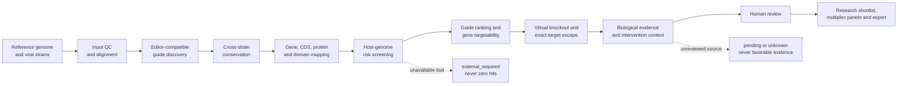
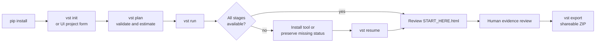

# ViralSafeTarget

ViralSafeTarget is a virus-first computational research toolkit for conserved guide
discovery, explicit host-search status, virtual-knockout sequence hypotheses,
exact-target escape robustness, multiplex comparison, and source-linked evidence review.

> The outputs are computational research hypotheses. They do not establish editing,
> safety, viral inhibition, delivery, treatment, clearance, or cure. No wet-lab protocol
> is provided.

## Five-minute start

```bash
python -m venv .venv
source .venv/bin/activate
pip install "viral-safe-target[ui,notebooks]"
vst --version
vst doctor
```

Prefer a visual workspace? Launch the installed local interface:

```bash
vst ui
```

The interface creates projects, previews runtime and disk estimates, runs or resumes
available stages, shows the active stage in a live workflow map with best-effort ETA,
exposes missing external results, and opens the final research bundle.
It runs locally; no retired server or remote service is assumed.

Create and run the bundled demonstration:

```bash
vst quickstart --out demo-project
vst plan demo-project/project.yaml
vst run demo-project/project.yaml
vst open demo-project/results
```

See the tested [five-minute quick start](docs/getting-started/FIVE_MINUTE_QUICKSTART.md).

## How the research pipeline works



The workflow asks a different question at every layer:

| Layer | Question | Research output |
|---|---|---|
| Inputs and QC | Are the reference, strains, annotation, host, and editor compatible? | Validated project and provenance |
| Discovery | Where can the selected editor target the viral genome? | Candidate guide coordinates |
| Conservation | Which exact guide/PAM sites persist across strains? | Population-support measurements |
| Annotation | What gene, coding sequence, protein, or domain is affected? | One-to-many biological mappings |
| Host-risk | Which host similarities were found under the declared search model? | Explicit hits or `external_required` |
| Disruption and escape | What bounded sequence outcomes and exact-target losses are possible? | Testable computational hypotheses |
| Evidence | What was shown directly, in an ortholog, or not yet reviewed? | Source-linked human-review queues |
| Decision support | Which guides and multiplex panels merit independent evaluation? | Auditable shortlist and portable report |

These layers are deliberately **not collapsed into a therapeutic score**. A technically
strong guide, a targetable gene, strong biological evidence, and sequence-level escape
robustness are related but different properties.

## Researcher workflow



The UI, command line, and canonical notebook call the same public workflow rather than
implementing separate scientific logic.

## New-virus quick start

```bash
vst init my-virus --interactive
vst plan my-virus/project.yaml
vst run my-virus/project.yaml
vst status my-virus/project.yaml
vst resume my-virus/project.yaml
vst open my-virus/results
vst export my-virus/project.yaml
```

The wizard supports an NCBI accession or local FASTA/GFF3 files, aligned or unaligned
strain panels, a host profile or local host FASTA, and explicit sequence-only mode.
MAFFT, Cas-OFFinder, and CRISPRitz remain external programs; missing results remain
`external_required`, never zero.

### What a researcher receives

Every completed or partial project produces one readable entry point and machine-readable
supporting files:

```text
results/
├── START_HERE.html
├── SUMMARY.md
├── summary.json
├── top_guides.csv
├── top_genes.csv
├── research_shortlist.csv
├── multiplex_panels.csv
├── evidence_review_queue.tsv
├── guide_explanations/
├── stage_timings.json
├── run_manifest.json
└── export.zip
```

## Canonical notebook

External researchers should use one notebook:

[`notebooks/00_VIRALSAFETARGET_END_TO_END_EN.ipynb`](notebooks/00_VIRALSAFETARGET_END_TO_END_EN.ipynb)

It supports `demo`, `hsv2_snapshot`, and `custom_project` modes and calls the installed
public CLI rather than duplicating algorithms. Earlier scientific and teaching notebooks
are preserved under [`notebooks/advanced/`](notebooks/advanced/) and
[`notebooks/learning/he/`](notebooks/learning/he/).

## Completed HSV-2 results

The frozen exhaustive snapshot reports 28,578 initial sites, 23,108 eligible candidate
coordinates, 21,654 unique guide sequences, 109/109 Cas-OFFinder batches, 440,341
predicted human matches under the configured model, and 2,668 candidate rows without a
predicted match under that model. UL3, UL10, UL52, UL47, and UL11 lead gene-level
targetability; the leading individual guide is `VST-2e9f052157f9bf29` in UL36.

These are targetability observations, not biological or therapeutic rankings. Start at
the [results index](reports/README.md), the
[exhaustive report](reports/hsv2_genome_wide_exhaustive/report.html), the
[virtual-knockout/escape findings](reports/hsv2_virtual_knockout_escape/FINDINGS.md),
and the [systematic benchmark](docs/workflows/SYSTEMATIC_TOOL_BENCHMARK.md).

Reproduction is explicit and resumable:

```bash
vst reproduce hsv2        # plan only
vst reproduce hsv2 --execute
```

## What the workflow keeps separate

1. Guide sequence quality and population conservation.
2. Model-bounded host-search results and missing external output.
3. Gene-level targetability.
4. Size-defined protein-disruption hypotheses.
5. Exact-target sequence escape robustness.
6. Direct-virus, ortholog, pending, and unknown biological evidence.

No combined therapeutic score is produced. The benchmark compares compatible exported
results from CRISPOR, CHOPCHOP, CRISPRitz, GuideScan2 and other tools while preserving
missingness and provenance.

## Tool and evidence ecosystem

The local UI includes a **Tool & evidence hub**. It detects MAFFT, Cas-OFFinder, and
CRISPRitz; validates researcher-supplied exports from CRISPOR, CHOPCHOP, and GuideScan2;
and keeps measured CRISPResso2 results separate from predictions. The Evidence Agent uses
documented PubMed/NCBI, Europe PMC, and UniProt APIs and always routes proposed biological
claims through human review.

See the audited [tool ecosystem and interoperability guide](docs/reference/TOOL_ECOSYSTEM_AND_INTEROPERABILITY.md)
for exchange formats, current support, official sources, and explicitly labelled roadmap
connectors for protein annotation and intervention evidence.

## Documentation and development

- [Documentation](docs/README.md)
- [New-virus workflow](docs/getting-started/NEW_VIRUS_WORKFLOW.md)
- [Notebook index](notebooks/README.md)
- [Scientific boundaries](DISCLAIMER.md)
- [Contributing](CONTRIBUTING.md)

```bash
python -m pip install -e ".[dev,notebooks]"
pytest -q
ruff check .
```

Use [`CITATION.cff`](CITATION.cff) for citation. The project is licensed under the
[MIT License](LICENSE).
